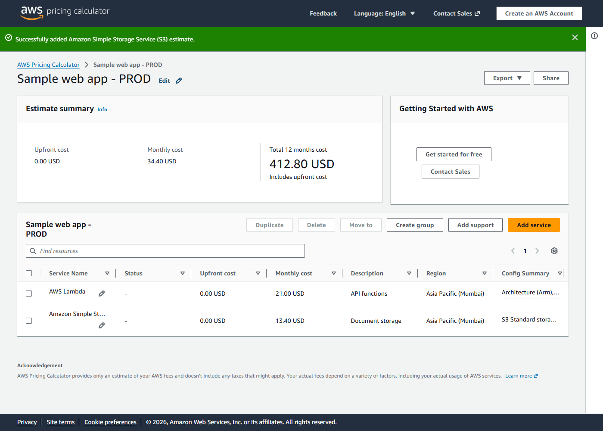

# cloud-pricing-calculator

A Claude skill (also usable on its own from the command line) that builds cost estimates **in the official
Azure Pricing Calculator and AWS Pricing Calculator**, from a JSON description of the services, using Playwright.

You get what the vendor's own calculator produces:

1. a share link to the estimate on azure.microsoft.com or calculator.aws;
2. the calculator's own export (Azure: Excel; AWS: CSV / JSON / PDF);
3. per-service monthly costs and totals as JSON;
4. a screenshot of each estimate;
5. optionally (Azure), the estimate saved in your Microsoft account's "Saved estimates".

No prices are hard-coded: the numbers are whatever the calculator shows on the day you run it.



*An estimate the skill built from [`examples/aws-serverless-web-app.json`](skills/cloud-pricing-calculator/examples/aws-serverless-web-app.json):
named, described, priced, exported and shared without a click.*

## Why

Both calculators are point-and-click only: neither has an API to create an estimate. Retyping a
twenty-line estimate for Dev, QA and Prod, then again every time the design changes, is slow and error-prone.
This skill keeps the estimate as a reviewable file and replays it.

## Install

### As a Claude Code plugin (recommended)

Inside Claude Code:

```
/plugin marketplace add lokeshdaiya/cloud-pricing-calculator
/plugin install cloud-pricing-calculator@cloud-pricing-calculator
```

Claude then uses the skill whenever you ask for an Azure or AWS estimate, and runs `npm install` in the
skill folder the first time it needs the scripts.

### With the skills CLI (Claude Code, Cursor, Codex and other agents)

```
npx skills add lokeshdaiya/cloud-pricing-calculator
```

This uses the open [skills](https://skills.sh) installer and works with any agent it supports.

### By hand

Copy `skills/cloud-pricing-calculator/` into `~/.claude/skills/` (personal) or `.claude/skills/` in a project,
then run `npm install` inside it.

### Browser

The scripts use Playwright's Chromium if installed (`npx playwright install chromium`), otherwise an installed
Chrome or Edge, or the executable in `CPC_BROWSER`.

## Use it directly

From `skills/cloud-pricing-calculator/`, after `npm install`:

```bash
# Azure: find product slugs and field names, then build
node scripts/azure-discover.js --search "postgres"
node scripts/azure-discover.js postgresql --select '{"tier":"generalpurpose"}'
node scripts/azure-build.js examples/azure-web-app.json --out out
node scripts/azure-build.js examples/azure-web-app.json --share --save   # opens a browser to sign in once

# AWS: find field labels, then build (share link included, no sign-in)
node scripts/aws-discover.js "AWS Lambda" --options
node scripts/aws-build.js examples/aws-serverless-web-app.json --out out
```

Spec formats, tested field names and pricing gotchas: [references/azure.md](skills/cloud-pricing-calculator/references/azure.md),
[references/aws.md](skills/cloud-pricing-calculator/references/aws.md). The workflow Claude follows is in [SKILL.md](skills/cloud-pricing-calculator/SKILL.md).

## Options

| Script | Option | Meaning |
|---|---|---|
| both builders | `--out <dir>` | output folder (default `out-azure/` or `out-aws/` next to the spec) |
| both builders | `--only "<name>"` | build only the estimate with this name |
| both builders | `--headed` | show the browser while it works |
| `azure-build.js` | `--share` | create a share link (needs a Microsoft account sign-in) |
| `azure-build.js` | `--save` | also save to "Saved estimates" in the account |
| `azure-build.js` | `--currency INR` | price in another currency the calculator offers |
| `azure-build.js` | `--profile <dir>` | where the sign-in is kept (default `~/.cloud-pricing-calculator/azure-profile`) |
| `aws-build.js` | `--no-share` | skip the public share link |

Exit codes: `0` success, `3` built but at least one field was not set (lines starting with `!` say which),
`1` failed, `2` usage error or no sign-in.

## Limits

1. These are live websites; a redesign can break a step. Fields are matched by name (Azure) or visible label
   (AWS) rather than layout, which survives most changes, and the discovery scripts show the current names.
2. Azure share and save need a Microsoft account. The script never handles credentials: you sign in yourself in
   the browser window it opens, and the session is kept in a local profile folder.
3. Anything the calculators don't price (third-party APIs, licences, support, people) has to be added separately.

## License

MIT. Not affiliated with or endorsed by Microsoft or Amazon Web Services.
